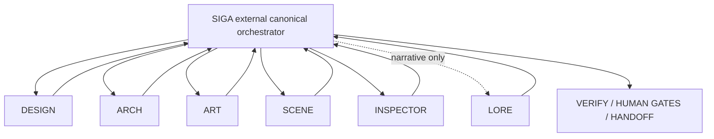

# MemeMon — Skills operating model V1

| Canonical | Accepted aliases | Ownership |
|---|---|---|
| SIGA | ORCHESTRATOR | Dispatch, claims, verification, reporting and handoff |
| DESIGN | — | Game design and mechanics |
| ARCH | — | Engineering integrity |
| ART | ARTIST | Art direction and approval |
| SCENE | CENA | Godot scene implementation |
| INSPECTOR | LENTE | Independent inspection |
| LORE (on demand) | — | Narrative and world |
| SIGA/HANDOFF | REPORTER, RELATORIO | Report formatting, not a separate executor |

Route: reconcile -> classify -> acquire exclusive claim -> specialist execute -> domain reviews -> independent verification -> human gate when needed -> exact-head checks -> protected merge -> release claim -> handoff.

Conflict: if active claim belongs to another run, WATCH. Never launch duplicate branch/task, overwrite owner, bypass required review or force unlock. Claim store and tests are pending implementation; until verified, SIGA must serialize dispatch and fail closed.
